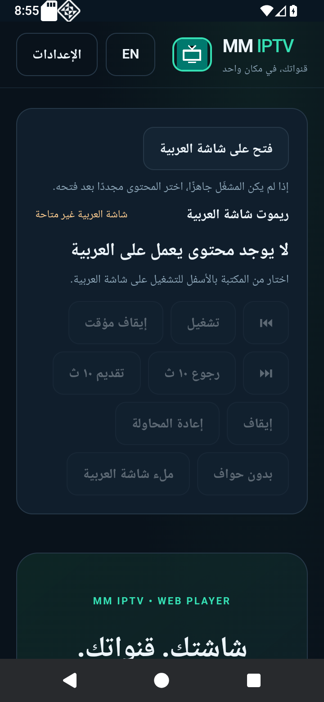
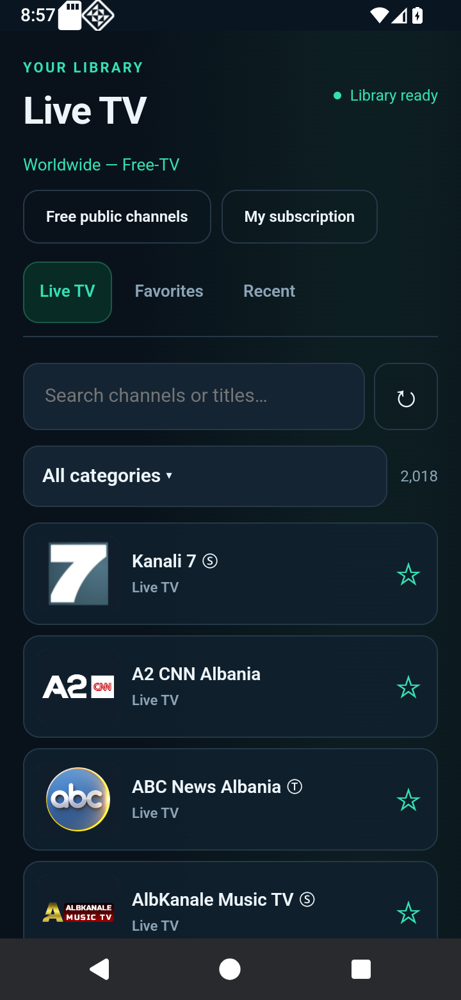

# MM IPTV

[English](README.md) · **[تحميل MM IPTV](https://github.com/moustafamagdi/MagdiIPTV/releases/latest)** · [التثبيت من MM Auto](https://github.com/moustafamagdi/MM-Auto)

تصفّح القنوات والأفلام والمسلسلات من مصدر IPTV الخاص بك، وتحكّم في تشغيلها على شاشة Android Auto. الموبايل للتحكم فقط، بدون تشغيل صوت أو فيديو عليه.

| التحكم بالعربي | مكتبة القنوات العامة |
| --- | --- |
|  |  |

## المميزات

- إضافة اشتراك Xtream أو قائمة M3U الخاصة بك.
- تصفّح قوائم قنوات عامة مجانية بدون اشتراك.
- البحث في القنوات والأفلام والمسلسلات والتنقل بين الأقسام.
- عرض لوجوهات القنوات والبوسترات والوصف عندما يوفّرها المصدر.
- حفظ المفضلة والمحتوى الأخير ومكان التوقف في الأفلام والحلقات.
- تشغيل وإيقاف مؤقت وإيقاف، وتحريك وقت التشغيل وتقديم أو رجوع عشر ثوانٍ عند دعم المصدر.
- فولسكرين مع اختيار الصورة كاملة أو ملء العرض وقص الأطراف، وأزرار تختفي أثناء التشغيل.
- واجهة عربية وإنجليزية وكيبورد بأرقام ورموز.

## البداية

1. ثبّت التطبيق من **MM Auto** أو حمّل ملف **APK** من أحدث إصدار. يحتاج أندرويد 11 أو أحدث.
2. اختار **قنوات عامة مجانية**، أو **إضافة / تعديل الحساب** لإضافة اشتراكك أو قائمتك.
3. وصّل Android Auto وافتح **MM IPTV** على شاشة العربية.
4. تصفّح من الموبايل واختار المحتوى. زر **فتح على العربية** يطلب فتح الواجهة إذا كان جهازك يدعم ذلك.

التطبيق لا يتضمن اشتراكًا مدفوعًا. القوائم العامة تقدّم قنوات مباشرة، وتوفّرها يختلف حسب القناة والبلد. الأفلام والمسلسلات والوصف يعتمدون على المصدر الذي تضيفه.

أيقونة **MM IPTV Audio** للتحكم في التشغيل الموجود على العربية. لو التطبيق الأساسي مش ظاهر، استخدم دليل الإعداد داخل MM Auto. التوافق يختلف حسب الموبايل والعربية. ثبّت التحديث فوق النسخة الحالية للاحتفاظ بالإعدادات والمفضلة، واستخدم الفيديو أثناء الوقوف.

## المساعدة والخصوصية

من **الإعدادات ← الدعم والتشخيص** يمكنك نسخ رقم الدعم أو إرسال تقرير. يمكنك إيقاف التقارير التقنية التلقائية من نفس الصفحة؛ التقارير لا تشمل بيانات الحساب أو عناوين المزود أو روابط البث أو أسماء المحتوى الذي تشاهده.

[الإبلاغ عن مشكلة](https://github.com/moustafamagdi/MagdiIPTV/issues/new) · [تفاصيل الخصوصية](SUPPORT.md) · [MM Tube](https://github.com/moustafamagdi/MagdiTube)

مشروع مستقل غير تابع لـGoogle أو Android Auto أو مزودي القنوات.
