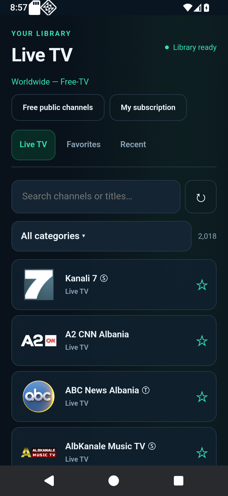
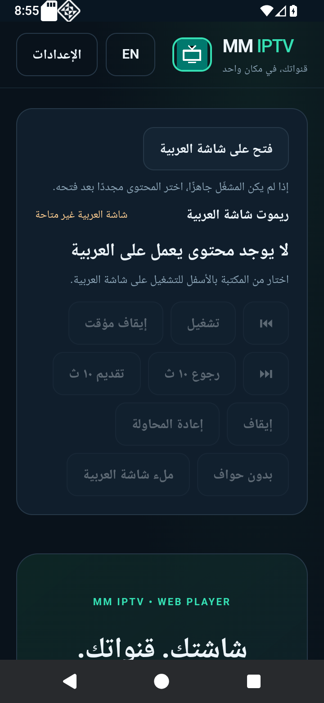

# MM IPTV

[العربية](README.ar.md) · **[Download MM IPTV](https://github.com/moustafamagdi/MagdiIPTV/releases/latest)** · [Install with MM Auto](https://github.com/moustafamagdi/MM-Auto)

Browse live channels, movies and series from your IPTV source, and control playback on your Android Auto screen. Your phone is the controller; it does not play audio or video.

| Public channel library | Arabic phone controller |
| --- | --- |
|  |  |

## Features

- Connect your Xtream subscription or M3U playlist.
- Browse free public channel directories without a subscription.
- Find channels, movies and series with search and categories.
- See channel logos, posters and descriptions when your source provides them.
- Keep favorites, recent items and saved movie or episode positions.
- Control Play/Pause, Stop, supported seeking and ten-second jumps from the phone.
- Use fullscreen with the full picture or a cropped Fill view, and controls that hide while playing.
- Arabic and English interface and an on-screen keyboard with numbers and symbols.

## Get started

1. Install through **MM Auto**, or download the **APK** from the latest release. Android 11 or later is required.
2. Choose **Free public channels**, or **Add / edit account** to connect your own subscription or playlist.
3. Connect Android Auto and open **MM IPTV** on the car screen.
4. Browse on the phone and select what you want to play. **Open on car** can request the car interface when supported.

The app does not include a paid subscription. Public directories offer live channels; availability varies by broadcaster and country. Movies, series and descriptions depend on your source.

The **MM IPTV Audio** entry controls existing car playback. If the main app is missing, use MM Auto's setup guide. Android Auto compatibility varies by phone and car. Install updates over your current app to retain settings and favorites. Use video while parked.

## Help and privacy

Open **Settings → Support & diagnostics** to copy your Support ID or send a report. Automatic technical reports can be turned off there; they exclude account credentials, provider addresses, stream links and watched titles.

[Report an issue](https://github.com/moustafamagdi/MagdiIPTV/issues/new) · [Privacy details](SUPPORT.md) · [MM Tube](https://github.com/moustafamagdi/MagdiTube)

Independent project, not affiliated with Google, Android Auto or channel providers.

[Development notes](docs/DEVELOPMENT.md) · [Third-party notices](licenses/)
